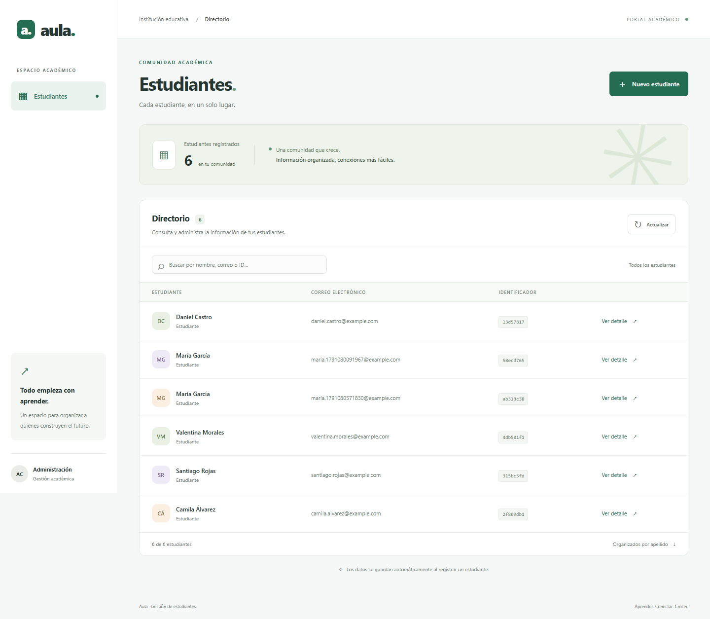

# Gestión de estudiantes

Este proyecto lo hicimos para la actividad de creación de una API REST y despliegue con contenedores. Usamos Java con Spring Boot para el backend y Angular para la interfaz.

La aplicación permite registrar estudiantes con nombre, apellido y correo, ver el listado y consultar los datos de cada uno por su identificador. También agregamos una búsqueda en la interfaz y validaciones para los campos obligatorios y los correos repetidos.



## Qué usamos

- Java 21 y Spring Boot.
- Angular 21 y TypeScript.
- Maven para las dependencias y la compilación del backend.
- H2 para trabajar desde el IDE y PostgreSQL para Docker local.
- Docker Compose para ejecutar los servicios juntos.
- Nginx para servir la interfaz y conectar las solicitudes con la API.
- AWS ECR, ECS y Fargate para la demostración en la nube.

## Cómo está organizado

El código está separado en `backend` y `frontend`. En `docs` dejamos las instrucciones y ejemplos de solicitudes. En `infra/aws` está la plantilla que usamos para preparar el despliegue.

En el backend, el controlador recibe las solicitudes, el servicio maneja las reglas de la aplicación y el repositorio se conecta con la base de datos. Los DTO definen los datos de entrada y salida. La estructura de la base se crea con migraciones de Flyway.

En Angular separamos la página del directorio, el formulario, los modelos y el servicio que llama a la API.

## Ejecutar desde VS Code u otro IDE

Se necesita un JDK compatible, como Java 21 o 25, y Node.js 24. El proyecto incluye Maven Wrapper, así que no hace falta instalar Maven por separado.

Abre la carpeta completa del proyecto. Si el IDE lo solicita, importa `backend/pom.xml` como proyecto Maven. Los siguientes comandos son para PowerShell en Windows.

En una terminal, desde la carpeta principal:

```powershell
cd backend
.\mvnw.cmd spring-boot:run
```

En otra terminal, también desde la carpeta principal:

```powershell
cd frontend
npm.cmd ci
npm.cmd start
```

`npm.cmd ci` instala las dependencias. Después puedes iniciar la interfaz solo con `npm.cmd start`. Si necesitas reinstalar las dependencias, detén Angular primero con `Ctrl + C` para evitar archivos bloqueados.

La interfaz abre en [localhost:4200](http://localhost:4200) y la API responde en [localhost:8080/students](http://localhost:8080/students). Mantén las dos terminales abiertas mientras usas la aplicación.

En Linux o macOS usa `./mvnw` y `npm` en lugar de los comandos terminados en `.cmd`. Si ejecutas la clase `StudentsApplication` desde el IDE, configura `backend` como carpeta de trabajo.

## Ejecutar con Docker

Abre Docker Desktop y espera a que el motor esté funcionando. Si tienes Angular o Spring Boot abiertos en las terminales, detén ambos con `Ctrl + C` para liberar los puertos.

Desde la carpeta principal, crea el archivo de configuración si todavía no existe:

```powershell
if (!(Test-Path .env)) { Copy-Item .env.example .env }
```

Abre `.env`, cambia el valor de `POSTGRES_PASSWORD` y guarda. Después ejecuta:

```powershell
docker compose up --build -d
docker compose ps
```

Esto inicia el backend, el frontend y PostgreSQL. La interfaz sigue estando en [localhost:4200](http://localhost:4200).

Para consultar los registros del backend o detener los contenedores:

```powershell
docker compose logs backend
docker compose down
```

`docker compose down` conserva los datos del volumen. Si agregas `-v`, también se elimina ese volumen y se pierden los estudiantes guardados.

## Endpoints

| Método | Ruta | Qué hace |
| --- | --- | --- |
| POST | `/students` | Registra un estudiante. |
| GET | `/students` | Lista los estudiantes. |
| GET | `/students/{id}` | Consulta un estudiante por su identificador. |

Para crear un estudiante se envía un JSON como este:

```json
{
  "firstName": "Laura",
  "lastName": "Gomez",
  "email": "laura@example.com"
}
```

La API devuelve esos datos y un campo `id` generado automáticamente. Una creación correcta responde con 201 y las consultas con 200. Los datos inválidos devuelven 400, un estudiante que no existe devuelve 404 y un correo repetido devuelve 409.

Para probar el listado desde PowerShell:

```powershell
curl.exe -i http://localhost:8080/students
```

Hay más ejemplos en [requests.http](docs/requests.http). También incluimos el [contrato OpenAPI](docs/openapi.yaml), que se puede importar en Postman.

La interfaz usa `/api/students`. El proxy de Angular o Nginx quita el prefijo `/api` antes de enviar la solicitud al backend.

## Base de datos y despliegue

Cuando ejecutamos desde el IDE, usamos H2 y los datos quedan en `backend/data`. Con Docker Compose usamos PostgreSQL y un volumen. Son bases separadas, por lo que los estudiantes creados en un modo no aparecen automáticamente en el otro.

Para la demostración en AWS subimos las imágenes a ECR y ejecutamos el frontend y el backend en una tarea de ECS con Fargate. Comprobamos el registro y la consulta desde la dirección pública, y la API respondió con HTTP 200 y los datos en JSON.

En esa demostración usamos H2 en memoria, como permite el enunciado. Los datos se pierden al detener o reemplazar la tarea. El despliegue fue para la actividad; no se garantiza que siga encendido ni que conserve la misma IP. Los pasos de configuración están en [la guía de AWS](docs/aws.md).

## Pruebas

Para ejecutar las pruebas del backend, desde la carpeta principal:

```powershell
cd backend
.\mvnw.cmd verify
```

Para las pruebas y la compilación de Angular, en otra terminal desde la carpeta principal:

```powershell
cd frontend
npm.cmd run test:ci
npm.cmd run build
```

También dejamos pruebas de navegador con Playwright. Con la aplicación local encendida, ejecuta desde `frontend`:

```powershell
npx.cmd playwright install chromium
npm.cmd run test:e2e
```

Estas pruebas crean estudiantes de ejemplo en la base conectada. La configuración de GitHub Actions ejecuta las pruebas del backend y de Angular, y compila ambas partes al subir cambios al repositorio.

## Archivos locales

El archivo `.gitignore` excluye las dependencias instaladas, los compilados, las bases locales y `.env`. Las contraseñas no se incluyen en el repositorio. `package-lock.json`, los Dockerfiles y las migraciones sí forman parte del proyecto.
